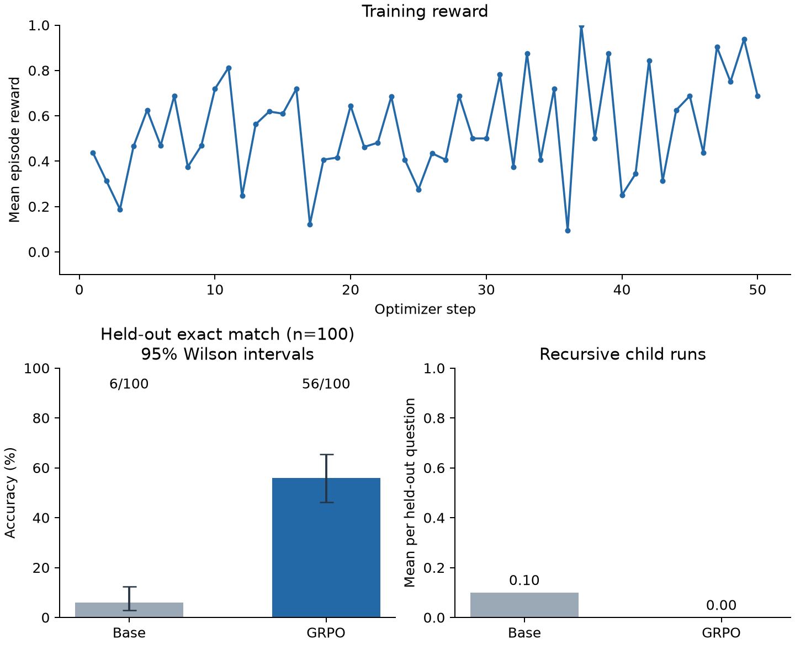

# GRPO on HotpotQA with OpenEnv's `repl_env`

Train a recursive language model to answer multi-hop questions. The Qwen3.5-4B root searches excerpts from ten Wikipedia
articles in a Python REPL and delegates evidence checks to a frozen Qwen3-0.6B child. GRPO trains a LoRA adapter
on the root, starting from the base model without SFT. Correct answers earn 1.0, wrong answers 0.0, and exhausting
30 REPL iterations without an answer earns -0.1.

This example implements the proposal by [@jucamohedano in huggingface/trl#8524](https://github.com/huggingface/trl/issues/8524)
and follows [@sergiopaniego's feedback](https://github.com/huggingface/trl/issues/8524#issuecomment-7109917454).
See the [tutorial](../../docs/source/tutorials/repl-hotpotqa-grpo.md) for the design and results.

## Measured result

After 50 optimizer steps from the base model, exact match rose from **6/100 to 56/100** on the same first 100
HotpotQA validation questions. The paired change was +50 percentage points (95% bootstrap interval: +40 to +60).
This single-run result supports improved REPL question answering. The trained model started **zero recursive
children** in evaluation and skipped them even in the guided examples, so it does not demonstrate learned
recursive or parallel reasoning. A separate manual check exercises the actual async child API.



See [results and provenance](results/) and the [tutorial](../../docs/source/tutorials/repl-hotpotqa-grpo.md) for
uncertainty, the continuation from checkpoint 10, dependency details, and observed hardware/time/cost.
The experiment cost about $10.50 in compute; the complete development/validation session cost about $17.06,
excluding storage and subscription fees.

## Scripts and requirements

| Script | What it does |
| --- | --- |
| `grpo.py` | Train and save a root LoRA adapter; log curves to Trackio |
| `merge.py` | Merge the saved adapter into its base model on CPU |
| `evaluate.py` | Evaluate held-out questions and write trajectories plus a summary |
| `analyze.py` | Plot saved training metrics and a matched evaluation comparison |

Each script carries its dependencies in a `# /// script` header. Use Python 3.12 with `uv run` and on HF Jobs. The Python minor version is fixed to the tested runtime so uv
does not select a newer interpreter that needs unsupported native dependency builds. Training and evaluation use TRL 1.18.0, vLLM 0.29.0, Transformers 5.24.1, and OpenEnv 0.14.0.
The REPL package is pinned to OpenEnv commit
`3659dc73eb8114724209e642eee749cd94348ce3`, which includes the isolated code-execution worker absent from v0.14.0.
Transitive dependencies are resolved by uv; these headers are not a full dependency lock.

The documented training backend needs a Linux NVIDIA GPU. Apple Silicon inference backends do not validate this
CUDA training recipe. The tested optimized configuration uses one RTX PRO 6000 96GB for the root, with the child served separately.

## Serve the child

Start the child before either training or evaluation. On a local CUDA machine:

```sh
vllm serve Qwen/Qwen3-0.6B --host 127.0.0.1 --port 8001 --gpu-memory-utilization 0.15 --max-model-len 8192
```

On HF Jobs, use a separate job with a token-protected exposed port:

```sh
hf jobs run --detach --expose 8000 --flavor a10g-small --timeout 8h -s HF_TOKEN \
    vllm/vllm-openai:v0.29.0 \
    vllm serve Qwen/Qwen3-0.6B --host 0.0.0.0 --port 8000 --gpu-memory-utilization 0.15 --max-model-len 8192
```

Wait for startup in `hf jobs logs -f <child-job-id>`. Its URL is
`https://<child-job-id>--8000.hf.jobs/v1`. Set `--child-url` to this URL on every training and evaluation job.
The scripts use `REPL_CHILD_API_KEY` when set, otherwise `HF_TOKEN` for `.hf.jobs` hosts. Local servers default to
an unused API key. Cancel the child with `hf jobs cancel <child-job-id>` when finished. Its timeout must cover all
jobs that use it; restart it and update the URL if needed.

Each child HTTP request has a 60-second timeout and no automatic retries. Managed recursive child runs also have
a 60-second deadline. These limits prevent a slow child request from silently retrying for many minutes.

## Local CUDA run

Install the dependencies declared in the script headers into your CUDA environment, then:

```sh
uv run grpo.py --output-dir ./adapter
uv run merge.py --adapter ./adapter --output ./merged
uv run evaluate.py --model Qwen/Qwen3.5-4B --output base.jsonl
uv run evaluate.py --model ./merged --output trained.jsonl
```

Both evaluations use the same first 100 validation questions, greedy decoding, thinking disabled, a 4096-token
completion budget including tool feedback, and a 6144-token context limit. Evaluation keeps four environments
open at a time and closes them between batches. Use `--num-questions 5` for a smoke test.

## HF Jobs with persistent outputs

Log in with `hf auth login` and configure billing. Create a private bucket once, then mount it on each job. Files
written only to a job's temporary filesystem are lost when it ends. Replace the values below:

```sh
BUCKET="<hf-user>/hotpotqa-grpo"
CHILD_URL="https://<child-job-id>--8000.hf.jobs/v1"
hf buckets create "$BUCKET" --private

hf jobs uv run --python 3.12 --flavor rtx-pro-6000 --timeout 4h --secrets HF_TOKEN \
    --env TRACKIO_DIR=/outputs/trackio --env TRACKIO_STORAGE_MODE=jsonl \
    -v "hf://buckets/$BUCKET:/outputs:rw" grpo.py \
    --output-dir /outputs/adapter --child-url "$CHILD_URL"

hf jobs uv run --python 3.12 --flavor cpu-upgrade --timeout 30m --secrets HF_TOKEN \
    -v "hf://buckets/$BUCKET:/outputs:rw" merge.py \
    --adapter /outputs/adapter --output "hf://buckets/$BUCKET/merged"

hf jobs uv run --python 3.12 --flavor rtx-pro-6000 --timeout 1h --secrets HF_TOKEN \
    -v "hf://buckets/$BUCKET:/outputs:rw" evaluate.py \
    --model Qwen/Qwen3.5-4B --child-url "$CHILD_URL" --output /outputs/base.jsonl

hf jobs uv run --python 3.12 --flavor rtx-pro-6000 --timeout 1h --secrets HF_TOKEN \
    -v "hf://buckets/$BUCKET:/outputs:rw" evaluate.py \
    --model /outputs/merged --child-url "$CHILD_URL" --output /outputs/trained.jsonl
```

`merge.py` serializes to a temporary local folder and synchronously transfers it when `--output` is a bucket URI.
This avoids relying on atomic weight-file renames on a mounted object store. Local folder outputs keep the usual
`save_pretrained` behavior. The transfer uses the standard Hub SDK sync operation without deleting existing files.

Run a short smoke test first: add `--max-steps 2` to training with a 30-minute timeout, then add
`--num-questions 5` to each evaluation with a 15-minute timeout. Use separate `smoke-adapter` and `smoke-merged`
output folders. These are timeout caps,
not measured runtimes. Check [current pricing](https://huggingface.co/docs/hub/jobs-pricing), including the child,
exposed-port surcharge, and bucket storage, before starting jobs.

The optimized GPU check completed two real Qwen3.5-4B training steps using `kernels==0.18.2` with
`use_kernels=True`: 211 seconds for the first step and 107 seconds for the second on an RTX PRO 6000 96GB.
These two steps provide a throughput estimate; generated trajectory lengths and child calls can change runtime.
The kernel loader version is constrained by Transformers 5.24.1. FLA and causal-convolution kernels are loaded
from the Hub; unavailable optional normalization kernels retain the reference implementation.

The default 50 training steps save checkpoints every 5 steps, retaining the latest two, the final adapter, and trainer state with logged
metrics. The scripts save artifacts without publishing a model. Jobs authentication is needed for the private
bucket and Jobs endpoint, independently of model publication.
The two Trackio environment variables above persist its logs in the bucket using JSONL instead of a SQLite
database on the mounted filesystem. Trainer metrics are also saved in `trainer_state.json` for `analyze.py`.

## Evaluation files

Each JSONL row contains the question ID, question, answer, submitted answer, exact-match flag, reward, turns,
recursive child-run counts (`delegations`, excluding direct `llm_query` calls), emitted and parsed tool-call counts, and the full conversation. Each run also writes
`<output>.summary.json`. Exact-match accuracy is the fraction of correctly submitted answers; mean reward is
reported separately because iteration-limit failures receive -0.1. Use the summaries and question IDs to compare
base and trained runs.

## Guided asynchronous demonstration and figures

To record a guided walkthrough alongside evaluation, pass `--demo-output async-demo.jsonl` to `evaluate.py`.
It uses the next three validation questions after the scored subset, with an extra instruction to launch a
nonblocking child, continue searching, and collect the child result. These guided trajectories are marked
`included_in_evaluation: false` and never enter the accuracy summary. Inspect the saved tool calls and outputs
before choosing a walkthrough for the tutorial; requesting a child query does not guarantee that the model uses it correctly.

Generate plots and machine-readable results directly from the saved artifacts:

```sh
uv run analyze.py --trainer-state ./adapter/trainer_state.json \
    --base base.jsonl --trained trained.jsonl --output-dir ./results
```

The analysis checks question IDs and initial prompts match, plots the actual training reward, and reports Wilson
95% accuracy intervals plus a paired bootstrap interval for the change. Those intervals describe question sampling
for one training run; they do not measure variation across training seeds.
It also writes `training.csv`, a paired `evaluation.csv` keyed by question ID, and `results.json` with the input-file
SHA-256 hashes, so the plotted values can be inspected without loading the full conversations.

## Optional publication after evaluation

Review the comparison before publishing an adapter. Download the adapter folder from the private bucket, then
authenticate with `hf auth login` and follow the [Hub upload instructions](https://huggingface.co/docs/huggingface_hub/guides/upload).
Publication is separate from training and evaluation. A local CUDA run against the public models and dataset does
not need a Hub token unless you choose to publish.
